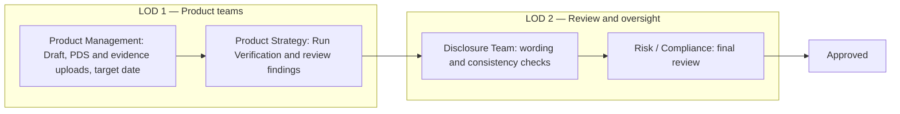

# ESG Disclosure Assurance System

A Vanguard-inspired academic prototype built with Next.js, React and TypeScript. It demonstrates separate PDS and screening evidence uploads, editable disclosure wording, disclosure approvals, simulated screening verification, overdue reviews, revision flags and ongoing concern monitoring. Teams use a role selector to review disclosures and address assigned concerns, with decisions and responses retained in Review History.

## Run locally

```bash
npm install
npm run dev
```

Open [http://localhost:3000](http://localhost:3000). For a production build, run `npm run build`, then `npm start`.

## Review workflow

**Product Management → Product Strategy → Disclosure Team → Risk / Compliance → Approved**

| Disclosure Status | Current action owner | Line of defence |
| --- | --- | --- |
| Draft | Product Management | LOD 1 |
| Pending Product Strategy Verification | Product Strategy | LOD 1 |
| Pending Disclosure Team Check | Disclosure Team | LOD 2 |
| Pending Risk/Compliance Review | Risk / Compliance Team | LOD 2 |
| Approved | Review complete | — |



1. **Product Management** creates a Draft and uploads the supporting PDS PDF. Uploading simulates extracting the supplied example disclosure wording from that file and displays it with the source filename. Product Management then uploads a separate supporting evidence file, reviews and edits the simulated Bloomberg/MSCI records, sets a target completion date and selects **Send to Product Strategy** with a comment. Supporting evidence must be uploaded and complete before submission.
2. **Product Strategy** reviews the supporting evidence prepared by Product Management. It can edit the screening records, replace the evidence file and edit disclosure wording, then select **Save supporting evidence** or **Save wording**. Any saved wording, evidence changes or replacement evidence file invalidate the previous verification result. Select **Run Verification** to check the saved wording against the fixed corporate-bond scenario. Wording beginning with **Some** and without **All** passes; evidence selections cannot make an All claim pass. Review methodology, issuer coverage, exclusions and limitations, then record decision comments and select **Approve** to send it to Disclosure Team. A discrepancy must be corrected and verified again or rejected.
3. **Disclosure Team (LOD 2)** views the verified screening evidence without editing it. In **Disclosure Team Review**, click **Pass**, **Needs revision** or **N/A** for **PDS disclosures**, **Website disclosures** and **Marketing materials**, then add **Review comments**. **Approve** is available only when all three items are Pass or N/A. If any item is Needs revision, only **Reject** is available. Approve sends the assessment to Risk / Compliance; Reject sends it to Product Management as **Draft**, with an additional **Revisions Required** badge. Checklist outcomes and comments are saved together with the decision; there is no separate save step.
4. **Risk / Compliance Team (LOD 2)** views the verified evidence without editing it and records decision comments. **Accept** marks the assessment **Approved**; **Reject** returns it to Product Management as **Draft**, with an additional **Revisions Required** badge.

Rejecting at any review stage returns the assessment to **Draft** with an additional **Revisions Required** badge and sends it to Product Management. The revision badge is a flag alongside the main workflow status. Product Management can edit it, address the reviewer comments and select **Resubmit to Product Strategy**. Resubmission removes the **Revisions Required** badge and clears the additional revision indicator, while the original rejection, reviewer comments and timestamp remain recorded in **Review History**. New Product Strategy verification and Disclosure Team review are required before Risk approval. Verification findings alone do not mark an assessment as requiring revision. **Internal Audit (LOD 3)** provides separate independent assurance and does not participate in management approvals.

## Dashboard and status badges

**Create disclosure** always appears at the top right of Product Management's dashboard. It creates a new Draft even when other disclosures are still being prepared or reviewed. The total disclosure count appears on the right of the **Disclosure register** header. Open a record from the register or use **Select disclosure** to switch between assessments.

The four main summary counts are **Draft**, **In review**, **Overdue** and **Approved**. Each saved disclosure counts once: approved records count under Approved; other records with a past target date count under Overdue; remaining records count under Draft or In review. For example, one Draft and one overdue Product Strategy review count as Draft **1**, In review **0**, Overdue **1**, Approved **0**.

Additional badges appear alongside the main Disclosure Status:

| Additional badge | When it appears | When it clears |
| --- | --- | --- |
| Revisions Required | A reviewer rejects an assessment and returns it to Draft | Product Management resubmits it to Product Strategy |
| Overdue | An unfinished assessment passes its target completion date | Its target date is no longer past due, or the assessment is approved |

A rejected assessment therefore displays **Draft** and **Revisions Required** together. The dashboard shows the revision count separately under **Additional status**, outside the four main counts. An overdue returned assessment can also display **Overdue**, but contributes only once to the main summary. Rejection details remain in Review History after resubmission.

**Disclosure Status** tracks the approval workflow. **Monitoring Status** tracks concerns raised after approval, as described below. Neither overdue badges nor revision badges add a step to the approval workflow.

## Supporting PDS uploads

Only Product Management can upload, replace or remove the current PDS while the assessment is Draft. PDFs up to 10 MB are supported. The file itself is retained in browser storage; reviewers can use **Open PDS** and **Download PDS**, including after reloading the app. File changes are recorded in assessment history. Submitted documents are locked during review.

The Draft starts with a highlighted **Upload the PDS** panel above the disclosure wording and a prominent **Upload PDS (PDF)** button. **Your actions** explains that choosing a PDS populates disclosure wording and Product Management uploads supporting evidence separately. After PDS upload, the panel points Product Management to the separate evidence upload, target completion date, submission comments and handoff to Product Strategy.

Uploading or replacing a PDF triggers **simulated extraction** of this supplied example disclosure. The wording appears only after upload and is linked to the uploaded file. Removing the PDS clears its extraction; replacing it starts a new extraction and resets the wording. This is an upload-driven simulation, not PDF text parsing:

> All corporate securities in the Fund are screened against ESG exclusion criteria

Verification uses a fixed unscreened corporate-bond scenario, **CORP-001**. Supporting evidence must still be uploaded and complete. Wording containing **All**, or wording that does not begin with **Some**, produces **Discrepancy identified** and **Unscreened security — CORP-001**, blocking approval. Changing Research available, Screening status or Fund inclusion cannot clear this result. Product Strategy must save wording beginning with **Some**, remove **All**, and run verification again.

Supporting evidence initially shows an empty, read-only Bloomberg example and stays empty after the PDS is uploaded. In Draft, Product Management uses **Upload supporting evidence file** to populate the simulated Bloomberg and MSCI records. Product Management can edit and save these records before submission; Product Strategy can edit and save them during verification. PDS uploads do not create or replace screening evidence. Existing independently uploaded evidence is retained if the PDS is replaced, and requires fresh verification.

Upload a PDS and supporting evidence as Product Management, send it to Product Strategy and run verification. The default wording fails with the fixed corporate-bond discrepancy. As Product Strategy, use **Edit wording**, change it to **Some corporate securities in the Fund are screened against ESG exclusion criteria**, select **Save wording**, then **Run Verification**. It now passes, regardless of the research availability and screening status selections. Add decision comments and select **Approve** to continue to Disclosure Team. Alternatively, reject with comments and have Product Management apply the wording amendment before resubmitting.

## Editing disclosure wording

After PDS upload, **Edit wording** is available to Product Management while Draft and to Product Strategy during verification. Edit the text, then select **Save wording** or **Cancel**. Empty wording cannot be saved. Save or cancel before submitting or recording a review decision. Saved changes invalidate earlier verification and are retained in Review History with the exact wording at each decision. Editing the displayed wording does not rewrite the uploaded PDF.

This is a deterministic wording check for the prototype. Only wording beginning with **Some** and containing no **All** passes. Other wording and evidence-field edits cannot bypass this check. Saving wording or evidence changes still requires a fresh verification run.

## Supporting evidence permissions

| Team | Supporting evidence permissions |
| --- | --- |
| Product Management | Upload and edit supporting evidence in Draft; upload and maintain the PDS |
| Product Strategy | Upload, edit and validate Bloomberg/MSCI screening evidence at its verification stage |
| Disclosure Team (LOD 2) | View evidence; complete the disclosure checklist and comment before approving or rejecting |
| Risk / Compliance (LOD 2) | View evidence; accept or reject the assessment and flag monitoring concerns after approval |
| Internal Audit (LOD 3) | Read-only independent assurance |

Product Management uploads a separate PDF, CSV, Excel (.xlsx or .xls) or text evidence file up to 10 MB while the assessment is Draft. Product Strategy can replace it during verification. Uploading simulates populating the supplied Bloomberg/MSCI example records; file contents are not parsed. The original file is stored in IndexedDB and can be downloaded by all teams. Replacing it repopulates the example fields and invalidates verification. Both Product Management in Draft and Product Strategy during verification can edit the populated records and select **Save supporting evidence**. Unsaved evidence changes block submission, verification and acceptance. Product Management must upload and complete evidence before submission; Product Strategy then runs verification. Previously saved evidence and decisions remain available.

## Ongoing Monitoring

The dashboard distinguishes **Disclosure Status** from **Monitoring Status**. Monitoring Status defaults to **Nil** during drafting and review and remains Nil after approval until Risk / Compliance flags a concern. Verification findings and overdue dates do not automatically activate monitoring.

| Monitoring Status | Meaning |
| --- | --- |
| Nil | No monitoring concern has been flagged |
| Active | At least one flagged concern is still Open |
| Addressed | Every flagged concern has been addressed by its assigned team |

Every team can access the **Ongoing Monitoring** tab and read concerns and responses for approved disclosures. Only Risk / Compliance sees **Raise a New Concern** and can use **Flag Concern**:

- **Concern Category**, including ESG screening coverage, methodology, exclusions or disclosure wording.
- **Risk Severity**: Low, Medium, High or Critical.
- **Concern Description**.
- **Assign Remediation To**: Product Strategy (ESG evidence / methodology), Product Management (PDS update) or Disclosure Team (disclosure wording).

Only Risk / Compliance can flag a concern, and only after disclosure approval. A flagged concern is recorded as **Open** with its assigned team and priority. **Monitoring Status** changes to **Active**, while **Disclosure Status** stays **Approved**. The dashboard shows flagged concerns and highlights any assigned to the current team.

The assigned Product Strategy, Product Management or Disclosure team must enter a **Remediation response** explaining its checks or corrections, then select **Mark addressed**. Other teams can read that response but cannot submit one on the assigned team's behalf. Internal Audit remains read-only. A concern becomes **Addressed**; monitoring stays Active while any concerns remain Open, and becomes **Addressed** when all have responses. Disclosure approval and verified source evidence stay unchanged.

Concerns and responses are saved with their disclosure in this browser and recorded in Review History for all roles. Earlier approved disclosures remain available when a new Draft is created. **Reset Demo** clears user-created assessments, concerns and uploaded files, then restores the working overdue example and its PDF.

## Target completion and overdue assessments

Product Management must set a **Target completion date** before submission. The assessment is due by the end of that date in **Asia/Singapore**. If it remains unfinished the following day, the dashboard, disclosure screen and history register flag it **Overdue**. Displays refresh every minute while the app is open. Passing a deadline does not prevent the responsible team from completing its review.

The dashboard includes **PDS-002 - Overdue Product Strategy example**, with a target completion date of **5 Nov 2026**. Its row is highlighted red while overdue and opens a working assessment at **Pending Product Strategy Verification**. The example simulates specialist methodology, issuer coverage, exclusions and limitations checks taking longer than planned. Product Strategy can edit and save the prepared Bloomberg/MSCI records, run verification and approve or reject; later review stages work normally. The example includes a stored, downloadable illustrative PDS PDF and a separate screening evidence CSV, and retains edits after reload. Existing saved examples retain their previous evidence.

Register tables use the column heading **Target completion date** and show only the formatted date in each row. Overdue warnings appear with the assessment status.

The example uses the same permissions, verification rules and approval flow as other assessments. Its status and dashboard counts update as teams complete the review. Approval clears its overdue warning; **Reset Demo** restores it to the pending Product Strategy stage.

## Controls and display

- Use the **Simulated role** selector to move between departments. There is no user selector or manual reviewer assignment.
- Only Product Management edits the Draft and uploaded PDS. Product Management can edit disclosure wording in Draft; Product Strategy can edit wording during its verification stage. Other teams view wording only.
- Product Management uploads and edits supporting screening evidence in Draft. Product Strategy reviews and edits it at its verification stage. Unsaved changes block running verification or accepting; saved changes require a fresh verification run. Disclosure Team records its separate LOD 2 review outcomes and comments without changing source records. Disclosure Team, Risk / Compliance and Internal Audit have read-only access to supporting evidence.
- Only the responsible role can accept or reject at the current stage. Self-approval is blocked. Comments are required for submission, acceptance and rejection.
- Accept/Approve buttons are green; Reject buttons are red. Status badges use grey for Draft, blue for Product Strategy, amber for Disclosure, purple for Risk/Compliance and green for Approved. Overdue warnings use red.
- Revisions Required is an orange add-on badge alongside Draft. Long status labels wrap inside padded badges.
- Decision history retains comments, document references, target dates, evidence snapshots and verification results.

## Available commands

| Command | Purpose |
| --- | --- |
| `npm run dev` | Start the development server |
| `npm run typecheck` | Check TypeScript types |
| `npm run build` | Create the production build |
| `npm start` | Serve the production build |

## Prototype scope and storage

PDS PDFs and supporting evidence files are stored in IndexedDB. Assessments, verification results, concerns, remediation responses and history are saved in localStorage. Data is local to the current browser and site origin.

**Reset Demo** clears user-created disclosures, uploaded PDS and evidence files, concerns, responses and their history, then recreates the overdue Product Strategy example and its downloadable PDS. Reloading without a reset preserves saved work and does not duplicate the example.

Supported recent saved assessments retain their current stage, evidence, comments, concerns and history when data is upgraded. Active verification results from the previous evidence-based rule are cleared for a fresh wording check; historical results remain recorded. Unchanged government-bond examples in Draft or Product Strategy verification upgrade to the corporate-bond example and require fresh verification; user-edited evidence and earlier history stay intact. Some older workflow versions return unfinished assessments to Draft or require the current Disclosure Team checklist; their earlier decisions remain in history.

Evidence is illustrative, not live Bloomberg or MSCI data. The automated tool checks one example security under simplified rules and does not establish full regulatory compliance. PDF extraction, website checks and marketing review outcomes are simulated. Roles and identities are simulated; the app has no authentication, server-side authorization or tamper-proof audit storage.
